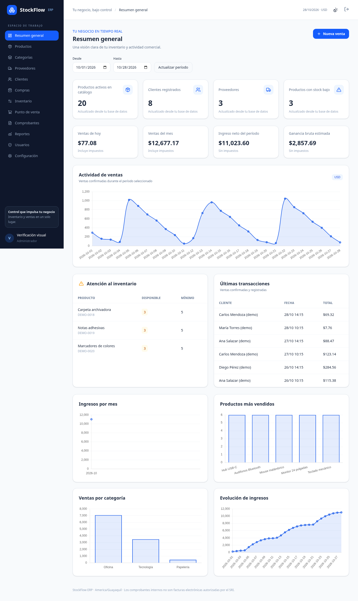

# StockFlow ERP

Aplicación de inventario y ventas con Laravel 13, PHP 8.5, MySQL 8.4, Blade,
Livewire 4, Alpine.js, Tailwind CSS, Chart.js, Lucide y DomPDF.



## Funciones disponibles

- Autenticación con Laravel Fortify: inicio/cierre de sesión, recuperación de
  contraseña, perfil, cambio de contraseña y administración de usuarios.
- Roles y autorización en el servidor; no existe registro público de usuarios.
- Catálogos de productos, categorías, proveedores y clientes, con búsqueda,
  filtros, paginación, desactivación e historial de actividad.
- Imágenes JPG/PNG/WebP, exportación de productos a CSV e importación validada
  de hasta 1000 filas. Un error revierte toda la importación.
- Compras pendientes y recepción completa que registra entradas de inventario.
- Movimientos con usuario, motivo, cantidad y saldos anterior/posterior;
  ajustes autorizados y alertas de stock mínimo.
- POS con búsqueda por nombre/SKU/código de barras, lector tipo teclado,
  carrito, impuestos, descuentos autorizados y pagos en efectivo, tarjeta o
  transferencia. El efectivo calcula cambio; los demás métodos requieren el
  importe exacto.
- Confirmación transaccional e idempotente de ventas, bloqueos MySQL para evitar
  sobreventa y anulación completa con reversión de inventario.
- Comprobantes internos PDF descargables e imprimibles, con datos históricos
  de empresa, cliente, precios, impuestos y categorías.
- Reportes diarios, mensuales, anuales, por vendedor/cliente/proveedor,
  productos más vendidos, sin movimiento, inventario, stock bajo y ganancia
  bruta estimada; exportación CSV y PDF.
- Dashboard con cinco gráficos, filtros por fechas, tema claro/oscuro y diseño
  responsive. Los datos se consultan en MySQL, incluidos los estados vacíos.

## Roles

| Rol | Alcance |
| --- | --- |
| Administrador | Todos los módulos; descuentos y anulaciones |
| Vendedor | Ventas, clientes, consulta de productos y comprobantes |
| Bodeguero | Productos, categorías, proveedores, compras e inventario |
| Contador | Consulta de ventas/pagos, comprobantes y reportes |

Los roles iniciales se crean mediante `DatabaseSeeder`. Las Policies protegen
los catálogos; los servicios y Gates verifican las operaciones comerciales.

## Entorno cloud preparado

Desde `/workspace/STOCKFLOW`:

```bash
bash bin/cloud-install
bash bin/cloud-start
bash bin/cloud-php php artisan stockflow:admin admin@tuempresa.com
```

El último comando solicita una contraseña de al menos 12 caracteres sin
mostrarla. No hay contraseñas de acceso predeterminadas. `cloud-install`
construye PHP con sus extensiones, instala los lockfiles, prepara MySQL,
aplica migraciones/roles y compila los recursos. Conserva la clave de aplicación
y las credenciales locales existentes. Rechaza una configuración DB personalizada
antes de sobrescribirla.

`cloud-start` comprueba MySQL y la respuesta del formulario de acceso. El
servidor de desarrollo escucha en el puerto 8000 de la máquina; no es un
servidor de producción ni una publicación web.

Los contenedores se llaman `stockflow-db` y `stockflow-app`; utilizan la red
`stockflow` y el volumen persistente `stockflow-mysql`. Los procesos deben
reiniciarse después de restaurar una instancia. No eliminar el volumen para
resolver errores de arranque: contiene los datos de desarrollo.

La red de instalación necesita los destinos oficiales de Composer, npm,
Docker y Debian; Composer descarga distribuciones mediante `api.github.com`.
El entorno cloud proporciona el proxy y su certificado. El Dockerfile recibe
ese certificado como secreto de BuildKit y lo retira de la imagen final.

## Instalación nativa en Windows

Consulta [docs/WINDOWS.md](docs/WINDOWS.md). Requiere PHP 8.5, Composer 2,
Node.js 24 y MySQL 8.4. El código y los comandos son compatibles con una
instalación nativa; la validación realizada aquí fue en Linux con MySQL real.

El archivo `.env.example` no contiene credenciales reales. Configura `.env`
según tu instalación y no lo subas a Git. Crea las bases `stockflow` y
`stockflow_test` con un usuario que pueda operar sobre ellas.

## Script SQL de MySQL

Incluye [database/sql/stockflow-schema.sql](database/sql/stockflow-schema.sql):
25 tablas con índices y relaciones, más el registro de las cinco migraciones
aplicadas. No contiene cuentas, contraseñas ni datos comerciales.

Puedes crear la estructura con `php artisan migrate --seed` o importar el SQL
en una base **nueva y vacía**. No combines ambas creaciones sobre tablas existentes.
Desde el cliente de MySQL:

```sql
SOURCE /ruta/al/proyecto/database/sql/stockflow-schema.sql;
```

En Windows utiliza una ruta con barras `/`, por ejemplo
`SOURCE C:/proyectos/STOCKFLOW/database/sql/stockflow-schema.sql;`.
Después de importar y configurar `.env`, ejecuta:

```bash
php artisan migrate --seed
php artisan stockflow:admin admin@tuempresa.com
# Opcional, sólo para desarrollo:
php artisan stockflow:demo
```

Las cinco migraciones iniciales quedan registradas: Laravel aplicará únicamente
las futuras. El seeder crea roles, permisos y configuración de empresa.

## Datos ficticios y primer uso

```bash
bash bin/cloud-php php artisan stockflow:demo
```

Carga una sola vez 20 productos, 8 clientes, 3 proveedores, 3 compras recibidas
y 62 ventas, empleando los servicios reales de inventario y ventas. Repetirlo
no duplica operaciones. El operador de la carga queda desactivado y no posee
una contraseña pública. El comando se rechaza en producción.

Después de crear tu administrador:

1. Configura nombre, RUC, dirección, logotipo, impuestos y numeración interna.
2. Crea categorías, proveedores, clientes y productos.
3. Recibe una compra o registra un ajuste inicial con motivo.
4. Abre el POS, selecciona cliente/productos, registra el pago y confirma.
5. Consulta el comprobante y revisa inventario y reportes.

## Desarrollo y validación

```bash
bash bin/cloud-php php artisan test --compact
bash bin/cloud-php vendor/bin/pint --test
npm run build
```

Las pruebas usan exclusivamente `stockflow_test` y pueden eliminar sus tablas.
Nunca apuntarlas a la base de trabajo o a producción. Las pruebas de concurrencia
lanzan procesos PHP independientes contra MySQL; no se sustituyen por SQLite.

Se verificaron 37 pruebas y 181 aserciones, incluidos autenticación, roles,
CRUD, CSV atómico, precios, recepción idempotente, stock insuficiente, pagos,
anulación, PDF, reportes, datos demo y dos carreras de ventas concurrentes.
Chromium verificó acceso real, gráficos, búsqueda Livewire, carrito, tema oscuro,
menú móvil y ausencia de desbordamiento horizontal tras ajustar los gráficos.

Para editar estilos ejecuta `npm run dev` en una terminal adicional. PHP y npm
usan sus respectivos lockfiles. Los comandos PHP nativos equivalen a los
mostrados sin el prefijo `bash bin/cloud-php`.

## Reglas de negocio y estructura

- Los importes se almacenan como `DECIMAL` y se calculan en centavos enteros;
  la media de costo utiliza BCMath y el formato monetario conserva decimales
  sin convertirlos a coma flotante. Impuestos redondeados por línea, mitad hacia
  arriba. `1500` puntos base representa 15 %.
- El ingreso neto es subtotal menos descuentos; la ganancia bruta estimada es
  ingreso neto menos costo histórico vendido. No incluye gastos operativos.
- Las recepciones actualizan el costo medio de compra. Cada venta conserva su
  costo unitario para que cambios posteriores no alteren su ganancia histórica.
- El stock se modifica a través de `InventoryService`, dentro de transacciones.
  Las operaciones bloquean productos en orden de ID. Ventas tienen una clave
  de idempotencia única y validan precios/stock en el servidor.
- Las anulaciones conservan documentos y pagos históricos, restituyen el stock
  una sola vez y se excluyen de los agregados de ventas.
- `app/Services`: lógica comercial; `app/Http/Requests`: validación;
  `app/Policies`: autorización de catálogos; `app/Livewire`: interacción;
  `app/Models`: relaciones Eloquent; `database`: migraciones, seeders y factories.

[Arquitectura y plan de implementación](docs/IMPLEMENTATION.md).

## Alcance y configuración externa

Los documentos son **comprobantes internos**, no facturas electrónicas
autorizadas por el SRI. No incluye firma digital, XML fiscal ni autorización
SRI. `DocumentRenderer` separa la generación del documento para facilitar una
integración futura, que requerirá sus propias reglas y pruebas tributarias.

Los pagos registran cobros declarados; no procesan tarjetas ni verifican
transferencias bancarias. La anulación permite devoluciones totales de stock;
los reembolsos monetarios se gestionan por separado. No hay recepción parcial
de compras ni devolución parcial de una venta.

El transporte de correo predeterminado es `log`. La recuperación de contraseña
usa el broker oficial, pero para entregar correos es necesario configurar
`MAIL_*` con un proveedor real. Los logs de desarrollo pueden contener enlaces
de recuperación y deben mantenerse privados.

La publicación del entorno cloud es independiente de subir código a GitHub y
de desplegar en producción. Publicar el repositorio no despliega la aplicación
en un servidor público. Antes de producción se necesita configurar servidor web, HTTPS,
correo, copias de seguridad, `APP_DEBUG=false` y operación de la base de datos.
